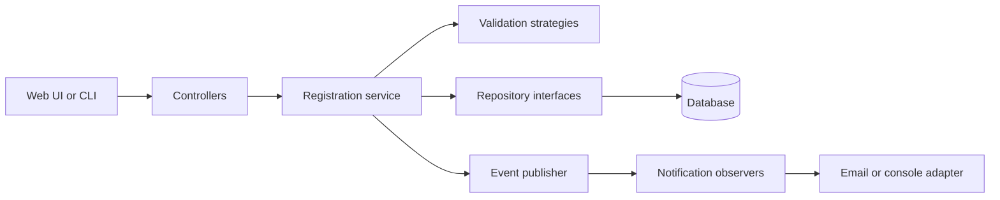
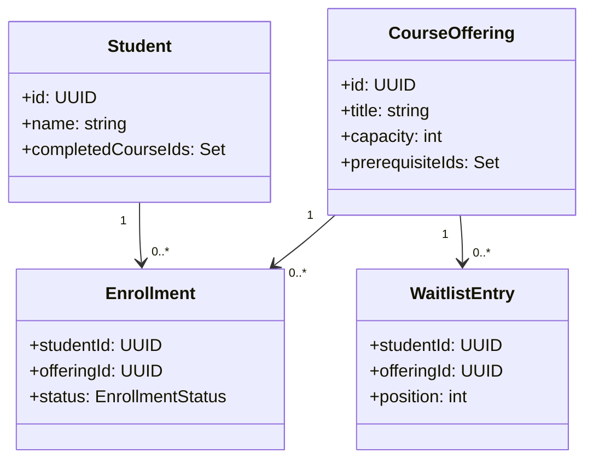

# SDP Final Project Blueprint: Course Registration System

A proposed final project for a Software Design Patterns (SDP) course. Students browse courses and enroll; administrators manage course offerings. The focus is on applying patterns to real design problems and explaining their trade-offs.

> This is a design blueprint, not a finished application. The technology choices and schedule are suggestions.

## Problem and requirements

Manual registration makes it difficult to track capacity, prevent duplicates, and notify students when a seat opens. This application keeps registration rules independent of the interface and database.

**Actors:** students and administrators. Authentication can be simplified for a classroom prototype.

1. Students view courses, schedules, available seats, and prerequisites.
2. Students enroll in or drop a course. The system prevents duplicate enrollments, over-capacity enrollment, and enrollment without prerequisites.
3. Eligible students can join a full course's waitlist once. When a seat opens, the first eligible student is enrolled and notified.
4. Administrators create and update offerings and view enrollment lists.
5. The system records enrollment outcomes and uses a replaceable notification channel.

Payments, transcript integration, and production-grade identity management are outside the first version.

## Architecture



Controllers translate input into application calls. The registration service coordinates use cases; domain objects hold core state and rules. Repository interfaces hide persistence, while notification adapters isolate external delivery. Dependencies point toward the domain and application layers.

## Design patterns

| Pattern | Use | Benefit | Trade-off |
| --- | --- | --- | --- |
| Strategy | Enrollment rules for capacity, prerequisites, and duplicates | Rules can be composed and tested independently | More small classes |
| Observer | Enrollment and seat-availability events notify subscribers | Registration does not depend on a specific notification channel | Delivery failures and ordering need handling |
| Factory Method | A notification factory creates a configured email or console sender | Clients avoid constructing channel-specific senders | Unnecessary if only one sender is ever needed |
| Repository | Course and enrollment repositories expose domain-focused operations | Tests can use an in-memory store | Must not hide transaction behavior |

For a small prototype, a list of rule objects and an in-process event publisher are sufficient. Add patterns only where they solve a design problem.

## Domain model



`EnrollmentStatus` is `ENROLLED` or `DROPPED`. Waitlist entries are ordered per offering and removed on promotion or withdrawal. Prerequisites refer to completed course identifiers, separate from offering identifiers.

## Main workflows

**Enroll:** Load the student and offering, check eligibility and duplicate enrollment, then check capacity. If a seat exists, save the enrollment and publish an enrollment event. If full, offer the eligible student a waitlist place. Return a clear result for each outcome.

**Drop and promote:** Mark the enrollment dropped, then inspect the waitlist in order. Recheck eligibility, remove ineligible entries, and promote the first eligible student. Commit the drop and promotion together, then publish notification events.

Capacity and duplicate checks must be enforced inside a transaction, with suitable locking or equivalent concurrency control. Add unique constraints for active enrollments and waitlist entries. Publish events after commit; for reliable production delivery, use a transactional outbox and retry failed notifications. A classroom prototype may use in-process events and document that delivery is best effort.

## Suggested implementation

- **Language:** Java 17 or later, using a CLI or REST API.
- **Persistence:** SQLite for the prototype; in-memory repositories for unit tests.
- **Testing:** JUnit for domain and service tests.
- **Packages:** `domain/`, `application/`, `infrastructure/`, and `presentation/`.

Suggested interfaces:

```java
interface EnrollmentRule {
    RuleResult check(Student student, CourseOffering offering);
}
interface EnrollmentRepository {
    boolean isEnrolled(UUID studentId, UUID offeringId);
    void save(Enrollment enrollment);
}
interface NotificationSender {
    void send(Notification notification);
}
```

These are starting points, not a complete API: repository operations must support transactions and capacity checks in the selected persistence implementation.

## Validation plan

- Unit test missing prerequisites, duplicate enrollment, available seats, and full courses.
- Test enrollment and drop, waitlist ordering, duplicate waitlist prevention, and promotion.
- Test that ineligible waitlisted students are skipped and notification failure does not undo a committed registration.
- Run an integration test with simultaneous attempts for the last seat; assert capacity is never exceeded.
- Demonstrate swapping console notifications for email and an in-memory repository for a database-backed implementation.

## Delivery plan

1. Finalize requirements, class diagram, and pattern responsibilities.
2. Implement entities, enrollment rules, and unit tests.
3. Implement enrollment, drop, waitlist, and event workflows.
4. Add persistence, transactions, and notification adapters.
5. Add a CLI or API, run integration tests, and prepare a demonstration explaining each pattern and its trade-off.

**Definition of done:** Core workflows work end to end, validation tests pass, run instructions are documented, and the team can explain where and why each pattern is used.
